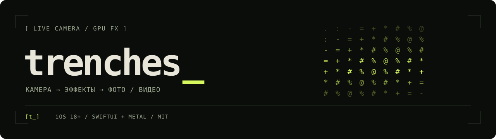

# trenches

Нативная камера для iPhone: снимай фото и видео с ASCII, свечением, смазом и цифровыми артефактами прямо в видоискателе. Эффекты сохраняются в готовом файле.

**iOS 18+ · SwiftUI · Metal · MIT**

[Установка](docs/INSTALLATION.md) · [Сборка](docs/BUILDING.md) · [Изменения](CHANGELOG.md) · [Лицензия](LICENSE)

## Что умеет

- Фото JPEG и видео MOV со звуком. 1080p/30, 1080p/60 и 4K/30 по возможностям камеры.
- Одиннадцать модулей эффектов можно сочетать и настраивать во время съёмки.
- Плавный зум во время записи, pinch, быстрые значения объективов, фронтальная камера, фокус касанием и сетка.
- Datamosh после записи с семью режимами, покадровым выбором диапазонов, сравнением с исходником и пресетами.
- При новом запуске все эффекты выключены. Значения параметров и сохранённые пресеты остаются.
- Пресеты, локальная галерея, сохранение в «Фото» и системное меню «Поделиться».
- Компактный интерфейс на русском: моноширинные подписи, ASCII-маркеры и лаймовый акцент. Liquid Glass — на iOS 26+.

| Эффект | Настройки |
| --- | --- |
| ASCII | ASCII, ASCII Blur и ASCII Glow с 11 наборами символов и выбором областей кадра |
| DOF | Художественное размытие или LiDAR/TrueDepth, фокус, глубина резкости |
| Bloom | Интенсивность и радиус свечения |
| Свет | Экспозиция, Reinhard / ACES, света и тени |
| Цвет | Температура, оттенок, насыщенность, контраст, гамма |
| POST FX | Зерно, виньетка, RGB-сдвиг, scanlines, халфтон, пикселизация |
| Dither | Bayer 2×2/4×4/8×8, Blue noise, White noise и шесть вариантов диффузии ошибки. Размер пикселя, порог, интенсивность, уровни, палитра и смешивание |
| Motion blur | Реальная выдержка камеры по углу затвора. При 30 к/с 180° задаёт 1/60 с, 360° — 1/30 с |
| Шакализация | JPEG-блоки, разрешение, цвет, масштабирование; звук: 3–16 бит, 2–48 кГц и смешивание |
| Macroblock | Блоки 8/16 px, смещение, доля блоков, частота обновления, seed |
| Lens flare | Отражённые блики, хроматическое смещение, текстура пыли, порог яркости; общий bright-pass с Bloom |

Dither обрабатывает результат POST FX, включая пикселизацию и халфтон. ASCII идёт последним и берёт цвета и яркость из получившегося кадра. Превью, JPEG и MOV используют тот же порядок обработки и масштаб сетки относительно ширины кадра.

Режимы диффузии обрабатывают участки 32×16 ячеек с запасом в шесть ячеек сверху и по бокам. Поэтому на границах участков рисунок может отличаться от последовательной обработки всего кадра. Bayer, Blue noise и White noise закреплены за сеткой кадра, чтобы рисунок не менялся случайно между кадрами.

## Datamosh

После остановки видео открывается редактор. Исходная запись остаётся в галерее; к ней можно вернуться через «Открыть Datamosh». В фото и live-превью этого эффекта нет.

Найдите нужный кадр на таймлайне и нажмите «Начало». Затем отметьте «Конец» на первом кадре, который должен снова стать чистым. Границы можно двигать за обе ручки или уточнять покадрово в настройках диапазона. Таймлайн приближается щипком и через меню. Выбранный участок можно зациклить со звуком, сравнить с исходником или развернуть видео, скрыв таймлайн.

«Перенос» оставляет изображение предыдущего кадра или выбранного кадра-источника и применяет к нему движение новой сцены. «Залипание» несколько раз повторяет одну команду межкадрового обновления. «Битые блоки» обновляет отдельные участки с ошибками. Дополнительно доступны «Распад», «Стоп-кадр», «Сбой векторов» и «Шлейф».

Настройки каждого диапазона включают размер блока, оценку движения, силу сбоя, постепенное восстановление к концу, seed и авто-сброс. В меню доступны ручной сброс накопления, отмена, повтор и поиск диапазонов на сменах сцен и пиках движения. Пресеты масштабируют позиции кадров под длину нового видео.

Metal вычисляет движение и остаток предсказания между исходными кадрами и применяет их к повреждённой опоре. При скраббинге кадры пересчитываются от начала диапазона или последнего сброса. Превью использует тот же анализ движения, что и экспорт, и уменьшает вывод до 720 px по длинной стороне. Результат сохраняется отдельным MOV в исходном разрешении через AVAssetWriter с копированием AAC без перекодирования.

## Установка

Скачай `trenches-1.3.1.ipa` во вкладке **Releases** и установи через [Sideloadly](https://sideloadly.io/) со своим Apple ID. Общий IPA требует собственной подписи.

Пошагово: [установка и обновление](docs/INSTALLATION.md).

## Совместимость

Минимум — **iOS 18.0**. На старых версиях используются доступные системные элементы, на iOS 26+ — Liquid Glass. LiDAR, TrueDepth, объективы и режимы записи зависят от устройства.

Проверено на **iPhone 15 Pro Max, iOS 27.0.1**: ASCII 6 px / 300%, 1080p/30 со звуком — **353 кадра, 30.00 FPS, без пропусков**. Это замер одной записи, не гарантия для любой цепочки эффектов. На физическом устройстве с iOS 18.x приложение пока не проверено.

Выход — SDR, 8 бит, портретный кадр 9:16. HDR, RAW, ProRes и обработка импортированного видео не поддерживаются. Эффекты записываются в изображение; исходник без них отдельно не сохраняется.

Исходник Datamosh содержит live-эффекты, выбранные при съёмке. [Архив проверок на iPhone](docs/VERIFICATION.md).

## Для разработчиков

Сборка через [xtool](https://github.com/xtool-org/xtool) и Swift Package Manager; рабочий процесс для Windows / WSL описан в [BUILDING.md](docs/BUILDING.md).

```bash
bash Trenches/scripts/build.sh -c release
```

Камера → Core Image / Metal → превью и кодировщик. Приложение работает локально: аккаунта, сервера, рекламы и аналитики нет. Камера, микрофон и добавление в «Фото» запрашиваются по мере необходимости.

Нашёл баг? Укажи модель iPhone, версию iOS, качество записи, эффекты и шаги воспроизведения в **Issues**.

Код и собственные ресурсы проекта — [MIT](LICENSE). Сборочные инструменты и системные фреймворки распространяются на своих условиях.
